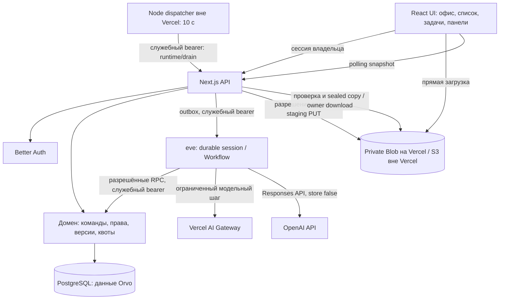

# Архитектура Orvo

## Поток данных

Владелец может иметь несколько офисов. Таблица `workspace_owners` связывает владельца с разрешёнными офисами; активный офис выбирается по HttpOnly-cookie и проверяется на сервере при каждом запросе. Все прикладные записи остаются изолированы существующим `workspace_id`. Новый офис создаётся пустым, получает дизайн `studio`, а создание и переименование не перемещают существующие данные.

Это приложение Next.js 16.4.2 с одним интегрированным runtime eve 0.80.1. `next.config.ts` использует официальный `withEve` из `eve/next`. Vercel-сборка — `npm run build` (`next build`), интеграция формирует service graph. Для собственного Node-хоста `npm run build:local` сначала собирает eve, затем Next. В разработке интеграция поднимает рядом отдельный Nitro-процесс eve и проксирует его маршруты. Сотрудники офиса — отдельные SQL-конфигурации с уникальными ID, настраиваемыми владельцем ролями, инструкциями, правами, лимитами, состоянием и областью памяти. Их число не связано с двенадцатью ролями [команды разработки](development-team.md).

## Модули

| Путь | Ответственность |
| --- | --- |
| `src/components/`, `src/app/` | Интерфейс, маршруты, стили, вход и HTTP API |
| `src/shared/types.ts` | Типы сотрудников, состояния задач и типы данных |
| `src/server/domain.ts` | Команды, транзакции, переходы, доступ, память, подтверждения, артефакты и квоты |
| `src/server/db.ts`, `scripts/embedded-db.mjs`, `migrations/` | PostgreSQL и миграции; отдельный IPC-процесс PGlite только для локальных проверок |
| `src/server/auth*.ts`, `owner.ts` | Better Auth, закрытое создание владельца, сессии |
| `src/server/runtime*.ts` | Создание/присоединение сессии eve, доставка управляющих команд из outbox |
| `src/instrumentation.ts`, `src/app/api/runtime/drain/` | Периодический Node dispatcher и защищённый endpoint доставки outbox |
| `agent/tools/run_task.ts`, `agent/lib/task-steps.ts` | Один Workflow с ограниченными этапами и проверками состояния |
| `agent/channels/eve.ts`, `agent/lib/domain-rpc.ts` | Служебная аутентификация и разрешённые вызовы доменной логики |
| `src/server/files.ts`, `blob-storage.ts` | Private Blob/S3, staging-разрешения, проверка, sealed-версия и скачивание через API владельца |
| `src/server/app-origin.ts`, `runtime-origin.ts` | Точный deployment origin, служебные Vercel OIDC/bypass headers |
| `src/server/rate-limit.ts`, `security-headers.ts`, `src/proxy.ts` | SQL-лимиты, CSP с nonce и защитные заголовки |
| `src/server/model-check.ts`, `openai.ts` | Проверка выбранного провайдера; прямой OpenAI Responses API, Gateway и явный тестовый режим |
| `src/server/seed.ts`, `scripts/` | Исторический fixture только для явного тестового режима, миграции, первичная настройка и диагностика |

## Источники истины

PostgreSQL хранит владельца/пространство, агентов, версии инструкций, проекты, память, задачи, привязки запусков и этапы, сообщения, подтверждения, материалы, версии результатов, использование, уведомления, аудит, rate buckets и идемпотентные команды. Связи и уникальные ограничения закреплены SQL-миграциями. Миграции домена выполняются транзакционно с advisory lock, согласующим cold starts; SQL-файлы включены в tracing API. Параллельные изменения используют версии, блокировки строк и транзакции; `requestId` не разрешает повторно выполнить команду с другими параметрами.

eve/Workflow хранит durable состояние исполнения и точки возобновления. `task.workflowRunId` и `task_runs.runtime_id` связывают задачу с сессией eve. SQL-состояния и события — проекция для интерфейса и одновременно источник доменных полномочий: новый шаг повторно читает задачу, права и квоты. Второго фонового генератора задач нет.

В тестовом режиме Next хранит один адаптер БД и запускает `scripts/embedded-db.mjs`: изолированный Node-процесс владеет PGlite/WASM, получает запросы по IPC и последовательно их выполняет. Это устраняет зависимость WASM БД от VM-контекстов Next. eve обращается к домену через `/api/runtime/domain` с серверным секретом и ограниченным перечнем операций. Запуск второго независимого владельца одного каталога PGlite не поддерживается. CLI миграций и создания владельца закрывают соединение перед выходом; рабочий режим по-прежнему использует обычный пул PostgreSQL.

Браузер получает snapshot, обычно раз в четыре секунды; при ошибках интервал растёт до 30 секунд. Отображаются состояние связи и время последней синхронизации. Общее правило определения состояния агента отдаёт приоритет активной работе/ожиданию перед старым результатом на проверке, чтобы офис и список показывали согласованный текущий статус. Разрыв связи не означает отмену принятого runtime задания. Черновик формы в `sessionStorage` — локальное удобство, не основной источник данных.

## Выполнение

`agent/agent.ts` содержит детерминированный маршрутизатор без платной модели, который передаёт ID серверной задачи в `run_task`. Он не создаёт содержание ответа. Специализированные этапы получают ограниченный контекст роли и вызывают выбранный OpenAI Responses API (`store:false`) либо `generateText({ model: gateway(model) })`; при явном `ORVO_TEST_MODE=1` на localhost и выбранном тестовом поставщике возвращают помеченный детерминированный текст. Значение `store:false` — параметр запроса, не обещание отсутствия хранения любых данных провайдером.

Командный запуск — до трёх выбранных последовательных сотрудников с передачей результата предыдущего этапа. Автоматическое назначение выбирает среди существующих сотрудников с учётом описания задачи, доступности и очереди, без обязательного перечня ролей. Это ограниченная оркестрация; произвольные рекурсивные поручения не реализованы. Другая роль той же модели не гарантирует независимое ревью.

До вызова атомарно резервируются токены и шаги. Входной резерв консервативно оценивается по размеру контекста; после ответа записываются сведения провайдера. Неоднозначный/оборванный вызов сохраняет резерв, чтобы повтор не обходил лимит. Цена остаётся неизвестной без подтверждённого источника; `cost_microusd` предусмотрен в схеме, фактический биллинг провайдера не интегрирован.

Для явных 429/5xx реализован ограниченный повтор: до трёх попыток на этап, durable `sleep`, состояние `retry_scheduled`, разбор `Retry-After` как числа секунд или даты, экспоненциальная задержка при его отсутствии. Текущий диапазон задержки — 1–30 секунд, в том числе при большем значении заголовка. После исчерпания попыток — ошибка; неизвестный сетевой исход не повторяется вслепую. SDK-повторы отключены (`maxRetries: 0`), чтобы управлением повторов занимался один Workflow.

Пауза и отмена проверяются на границах шагов; принятый провайдером запрос может завершиться и расходовать токены. Его ответ не должен запускать отменённую цепочку. Для ожидания уточнения/подтверждения используются durable `ctx.ask`, для расписания — Workflow `sleep`. Готовый Markdown сохраняется до принятия владельцем; правки создают следующую версию, максимум три цикла.

Публикация правила общей памяти требует отдельного сохранённого запроса с неизменными параметрами, сроком и версией задачи. Решение атомарно записывает память один раз, а outbox доставляет runtime конкретный связанный ответ. Прямой общий чат лишь сохраняет сообщение; создание автономной задачи требует явного действия.

`src/instrumentation.ts` регистрирует dispatcher раз в 10 секунд только на постоянном Node-хосте вне Vercel; он вызывает защищённый POST `/api/runtime/drain`. Endpoint владеет БД, dispatcher не открывает второй экземпляр PGlite. SQL lease и heartbeat согласуют доставку конкурирующими исполнителями. На Vercel интервал отключён: запросы `/api/state` и `/api/command` используют `after(() => drainRuntime(...))`. Пока отдельный scheduler не настроен, после сбоя доставки и без новых запросов pending outbox может остаться недоставленным. Принятое Workflow-задание и недоставленная команда — разные состояния. Локальное продолжение после перезапуска проверялось с тем же build/runtime; это не испытание нового Preview.

## Границы безопасности

Браузерские API проверяют сессию, владельца и точный origin изменяющих запросов. В Preview это неизменяемый `https://VERCEL_URL`, без wildcard-доверия ко всем preview-доменам. Runtime использует отдельный bearer `ORVO_RUNTIME_SECRET`; внутренний RPC к текущему Vercel deployment также передаёт trusted OIDC header (либо настроенный bypass fallback) для front-door protection. Это разные проверки: OIDC не заменяет bearer Orvo. Секреты не передаются клиенту и не хранятся в инструкциях. Результат отображается текстом, без выполнения полученного HTML/кода. Файлы и материалы считаются недоверенными данными.

На Vercel вложения используют private Blob, вне Vercel доступен S3-путь. Браузер получает краткоживущее разрешение на staging PUT, сервер проверяет размер и формат и закрепляет проверенные байты в отдельном приватном `sealed` объекте. Скачивание идёт через потоковый API после проверки владельца. Квота 500 активных файлов резервируется атомарно под блокировкой workspace; при новых загрузках ограниченная staging-уборка сохраняет метаданные и не удаляет ready/sealed. Прошли пять живых проверок Blob SDK, HTTP-проверки приватности и загрузка через браузерную форму задачи без CSP-ошибок.

Ошибки API ограничены безопасным перечнем, JSON читается с потоковым пределом, включая все auth POST до 16 384 байт. Auth-wrapper нормализует стандартный `Retry-After` из ответа библиотеки, интерфейс входа показывает ожидание при 429. Лимиты входа/API хранятся в SQL. `src/proxy.ts` добавляет CSP с nonce, Next — защитные заголовки. Эти заголовки и вход проверены в живом Preview; детали и пороги — в [security.md](security.md).

Нет shell, GitHub, почты и браузерного инструмента. Часть внутренних операций выполняется непосредственно оркестратором; модель не получает универсальный произвольный набор исполняемых инструментов. Память приложения — записи, подставляемые в контекст, без изменения весов модели. Удаление памяти отключает запись для новых шагов, но не стирает ранее отправленный провайдеру контекст.

## Известные ограничения

- На постоянном Node-хосте outbox доставляется dispatcher; на Vercel — после запросов. Без нового запроса повтор pending outbox не гарантируется. Hobby Cron не обеспечивает scheduler для Preview; дополнительное пробуждение пока не настроено.
- Повторы 429/5xx ограничены тремя попытками и задержкой до 30 секунд; произвольные сетевые ошибки и неизвестные исходы не дают безопасной гарантии автоматического повторения.
- HTTP `/api/health` — только liveness приложения, не полная проверка БД, Workflow, S3 и модели.
- Нет настоящего автоматического ответа общего чата, OCR, push/email/Telegram, генераторов офисных бинарных форматов, интеграции Ritm и жёсткого удаления всех персональных данных.
- Отдельные Neon Free и private Blob подключены только к READY Preview. Вход и реальный Workflow GPT-6 Luna до `completed` подтверждены; QA task/agent/файл удалены, лимиты восстановлены с CAS. Финальные SQL и браузер подтвердили пустой синхронизированный офис с настроенной моделью. Первый ошибочный Production deployment удалён; действующий Production не оставлен, ресурсы и backups не подготовлены. MFA отсутствует. Текущие результаты — в [progress.md](progress.md).
- Установленный eve 0.80.1 использует `.eve/.workflow-data` для локального world даже при попытке переопределить каталог окружением. Нельзя считать production и dev изолированными без отдельной рабочей директории/тома; topology и порядок сборки описаны в эксплуатации.
