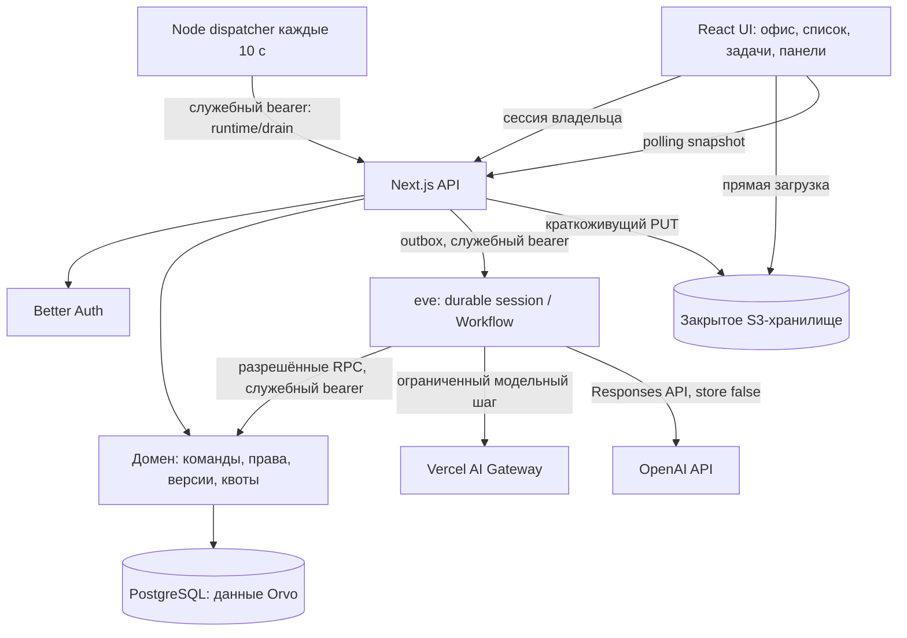

# Архитектура Orvo

## Поток данных

Это приложение Next.js с одним интегрированным runtime eve. `next.config.ts` использует официальный `withEve` из `eve/next`. В разработке интеграция поднимает рядом отдельный Nitro-процесс eve и проксирует его маршруты. Сотрудники офиса — отдельные SQL-конфигурации с уникальными ID, настраиваемыми владельцем ролями, инструкциями, правами, лимитами, состоянием и областью памяти. Их число не связано с двенадцатью ролями [команды разработки](development-team.md).

## Модули

| Путь | Ответственность |
| --- | --- |
| `src/components/`, `src/app/` | Интерфейс, маршруты, стили, вход и HTTP API |
| `src/shared/types.ts` | Типы сотрудников, состояния задач и типы данных |
| `src/server/domain.ts` | Команды, транзакции, переходы, доступ, память, подтверждения, артефакты и квоты |
| `src/server/db.ts`, `scripts/embedded-db.mjs`, `migrations/` | PostgreSQL и миграции; отдельный IPC-процесс PGlite только для локальных проверок |
| `src/server/auth*.ts`, `owner.ts` | Better Auth, закрытое создание владельца, сессии |
| `src/server/runtime*.ts` | Создание/присоединение сессии eve, доставка управляющих команд из outbox |
| `src/instrumentation.ts`, `src/app/api/runtime/drain/` | Периодический Node dispatcher и защищённый endpoint доставки outbox |
| `agent/tools/run_task.ts`, `agent/lib/task-steps.ts` | Один Workflow с ограниченными этапами и проверками состояния |
| `agent/channels/eve.ts`, `agent/lib/domain-rpc.ts` | Служебная аутентификация и разрешённые вызовы доменной логики |
| `src/server/files.ts` | Разрешения загрузки, проверка файлов, извлечение текста, закрытое скачивание |
| `src/server/model-check.ts`, `openai.ts` | Проверка выбранного провайдера; прямой OpenAI Responses API, Gateway и явный тестовый режим |
| `src/server/seed.ts`, `scripts/` | Исторический fixture только для явного тестового режима, миграции, первичная настройка и диагностика |

## Источники истины

PostgreSQL хранит владельца/пространство, агентов, версии инструкций, проекты, память, задачи, привязки запусков и этапы, сообщения, подтверждения, материалы, версии результатов, использование, уведомления, аудит и идемпотентные команды. Связи и уникальные ограничения закреплены SQL-миграциями. Параллельные изменения используют версии, блокировки строк и транзакции; `requestId` не разрешает повторно выполнить команду с другими параметрами.

eve/Workflow хранит durable состояние исполнения и точки возобновления. `task.workflowRunId` и `task_runs.runtime_id` связывают задачу с сессией eve. SQL-состояния и события — проекция для интерфейса и одновременно источник доменных полномочий: новый шаг повторно читает задачу, права и квоты. Второго фонового генератора задач нет.

В тестовом режиме Next хранит один адаптер БД и запускает `scripts/embedded-db.mjs`: изолированный Node-процесс владеет PGlite/WASM, получает запросы по IPC и последовательно их выполняет. Это устраняет зависимость WASM БД от VM-контекстов Next. eve обращается к домену через `/api/runtime/domain` с серверным секретом и ограниченным перечнем операций. Запуск второго независимого владельца одного каталога PGlite не поддерживается. CLI миграций и создания владельца закрывают соединение перед выходом; рабочий режим по-прежнему использует обычный пул PostgreSQL.

Браузер получает snapshot, обычно раз в четыре секунды; при ошибках интервал растёт до 30 секунд. Отображаются состояние связи и время последней синхронизации. Общее правило определения состояния агента отдаёт приоритет активной работе/ожиданию перед старым результатом на проверке, чтобы офис и список показывали согласованный текущий статус. Разрыв связи не означает отмену принятого runtime задания. Черновик формы в `sessionStorage` — локальное удобство, не основной источник данных.

## Выполнение

`agent/agent.ts` содержит детерминированный маршрутизатор без платной модели, который передаёт ID серверной задачи в `run_task`. Он не создаёт содержание ответа. Специализированные этапы получают ограниченный контекст роли и вызывают `generateText({ model: gateway(model) })`; при явном `ORVO_TEST_MODE=1` и выбранном тестовом поставщике возвращают помеченный детерминированный текст.

Командный запуск — до трёх выбранных последовательных сотрудников с передачей результата предыдущего этапа. Автоматическое назначение выбирает среди существующих сотрудников с учётом описания задачи, доступности и очереди, без обязательного перечня ролей. Это ограниченная оркестрация; произвольные рекурсивные поручения не реализованы. Другая роль той же модели не гарантирует независимое ревью.

До вызова атомарно резервируются токены и шаги. Входной резерв консервативно оценивается по размеру контекста; после ответа записываются сведения провайдера. Неоднозначный/оборванный вызов сохраняет резерв, чтобы повтор не обходил лимит. Цена остаётся неизвестной без подтверждённого источника; `cost_microusd` предусмотрен в схеме, фактический биллинг провайдера не интегрирован.

Для явных 429/5xx реализован ограниченный повтор: до трёх попыток на этап, durable `sleep`, состояние `retry_scheduled`, разбор `Retry-After` как числа секунд или даты, экспоненциальная задержка при его отсутствии. Текущий диапазон задержки — 1–30 секунд, в том числе при большем значении заголовка. После исчерпания попыток — ошибка; неизвестный сетевой исход не повторяется вслепую. SDK-повторы отключены (`maxRetries: 0`), чтобы управлением повторов занимался один Workflow.

Пауза и отмена проверяются на границах шагов; принятый провайдером запрос может завершиться и расходовать токены. Его ответ не должен запускать отменённую цепочку. Для ожидания уточнения/подтверждения используются durable `ctx.ask`, для расписания — Workflow `sleep`. Готовый Markdown сохраняется до принятия владельцем; правки создают следующую версию, максимум три цикла.

Публикация правила общей памяти требует отдельного сохранённого запроса с неизменными параметрами, сроком и версией задачи. Решение атомарно записывает память один раз, а outbox доставляет runtime конкретный связанный ответ. Прямой общий чат лишь сохраняет сообщение; создание автономной задачи требует явного действия.

`src/instrumentation.ts` регистрирует в постоянном Node-процессе один dispatcher: раз в 10 секунд он вызывает POST `/api/runtime/drain` со служебным bearer. Endpoint владеет доступом к БД, dispatcher не открывает второй экземпляр PGlite. Доставка outbox использует SQL lease и проверку heartbeat, чтобы согласовать конкурирующих исполнителей. Это позволяет повторять доставку pending outbox независимо от страницы. На serverless процесс может быть остановлен между запросами: нужен отдельный scheduler, вызывающий этот защищённый endpoint. Проверка `/api/state` и команды также могут инициировать доставку. Локальное продолжение после перезапуска проверено с тем же build/runtime; это не испытание облачного восстановления.

## Границы безопасности

Браузерские API проверяют сессию, владельца и origin изменяющих запросов. Runtime использует отдельный bearer `ORVO_RUNTIME_SECRET`; cookie владельца не является его служебной авторизацией. Секреты не передаются клиенту и не хранятся в инструкциях. Результат отображается текстом, без выполнения полученного HTML/кода. Файлы и материалы считаются недоверенными данными.

После валидации S3-вложения байты сохраняются под новым приватным `sealed` ключом: ранее выданный временный PUT URL не может изменить принятую версию. Этот путь реализован, но живое S3 не проверялось. Ошибки API выводятся только через разрешённый перечень доменных кодов; JSON читается с потоковым ограничением размера. Эти изменения и SQL leases включены после отдельного ревью четырёх найденных проблем.

Нет shell, GitHub, почты и браузерного инструмента. Часть внутренних операций выполняется непосредственно оркестратором; модель не получает универсальный произвольный набор исполняемых инструментов. Память приложения — записи, подставляемые в контекст, без изменения весов модели. Удаление памяти отключает запись для новых шагов, но не стирает ранее отправленный провайдеру контекст.

## Известные ограничения

- На постоянном Node-хосте outbox доставляется периодическим dispatcher; serverless требует внешнего scheduler. Локальный перезапуск того же build/runtime проверен без дублирования, облачная отказоустойчивость и восстановление после смены сборки не подтверждены.
- Повторы 429/5xx ограничены тремя попытками и задержкой до 30 секунд; произвольные сетевые ошибки и неизвестные исходы не дают безопасной гарантии автоматического повторения.
- HTTP `/api/health` — только liveness приложения, не полная проверка БД, Workflow, S3 и модели.
- Нет настоящего автоматического ответа общего чата, OCR, push/email/Telegram, генераторов офисных бинарных форматов, интеграции Ritm и жёсткого удаления всех персональных данных.
- Живая модель, S3 и восстановление облачного размещения требуют отдельных проверок с предоставленными подключениями.
- Установленный eve 0.80.1 использует `.eve/.workflow-data` для локального world даже при попытке переопределить каталог окружением. Нельзя считать production и dev изолированными без отдельной рабочей директории/тома; topology и порядок сборки описаны в эксплуатации.
